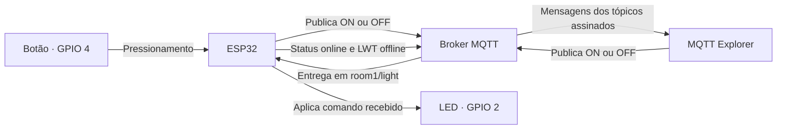

# ESP32 · Controle de LED via MQTT

Um botão físico, um LED e mensagens passando pelo broker: um protótipo de IoT
para explorar comunicação MQTT em ambientes inteligentes, desenvolvido em C com
ESP-IDF para o ESP32 DevKit com módulo ESP32-WROOM-32.

O LED pode ser controlado pelo botão da placa ou por um cliente como o
**MQTT Explorer**. A conexão do dispositivo é acompanhada por mensagens de
status e pelo **Last Will and Testament (LWT)** do protocolo MQTT.

## O que o projeto faz

- Recebe comandos `ON` e `OFF` para ligar e desligar o LED.
- Publica, a cada pressionamento do botão, o comando oposto ao último estado do LED.
- Filtra oscilações do contato do botão com debounce de 40 ms.
- Publica o status `online` e configura um LWT `offline`, ambos retidos.
- Tenta reconectar automaticamente após quedas de Wi-Fi e MQTT.
- Valida tópico, tamanho e conteúdo das mensagens antes de alterar a saída.

Esta etapa contempla LED, botão e comunicação MQTT. Sensores, dashboard,
regras de automação e publicação de confirmação do estado do LED ficam fora do
escopo atual.

## Como funciona



**O botão controla o LED por meio do broker.** Ele publica em `room1/light`,
mas o LED só muda quando o ESP32 recebe a mensagem de volta pela assinatura.
Assim, um comando do botão percorre o mesmo caminho de um comando enviado pelo
MQTT Explorer.

## Hardware e montagem

| Componente | Quantidade |
| --- | --- |
| ESP32 DevKit com ESP32-WROOM-32 | 1 |
| LED | 1 |
| Resistor de 330 Ω | 1 |
| Botão momentâneo | 1 |
| Protoboard, jumpers e cabo USB de dados | Conforme a montagem |

Faça as conexões com a placa desligada:

| Ligação | Conexão |
| --- | --- |
| LED | GPIO 2 → resistor de 330 Ω → ânodo do LED; cátodo → GND |
| Botão | GPIO 4 → botão → GND |

O LED é ativo em nível alto e inicia desligado. O botão usa o pull-up interno
do ESP32: solto corresponde a nível alto e pressionado, a nível baixo. Em botões
com quatro terminais, escolha contatos que fechem apenas ao pressionar; dois
terminais de cada lado podem já estar unidos internamente.

> GPIO 2 também é um pino de strapping. Não acrescente pull-up externo nesse
> circuito; se a gravação falhar, desconecte temporariamente o LED. Ao trocar
> pinos, confira o pinout: evite os da flash (6–11) e da serial (1 e 3). O botão
> precisa de um GPIO com pull-up interno; os GPIOs 34–39 do ESP32 clássico não
> oferecem esse recurso.

## Executando o projeto

### 1. Prepare o ambiente

Use uma instalação do [ESP-IDF](https://docs.espressif.com/projects/esp-idf/en/stable/esp32/get-started/)
com o ambiente ativado no terminal, ou abra o projeto no **VS Code com Dev Containers**.
A configuração em `.devcontainer/` utiliza a imagem oficial `espressif/idf`.

```sh
git clone https://github.com/MF853/MQTT_Project.git
cd MQTT_Project
```

O `dependencies.lock` registra ESP-IDF `6.2.0` e `espressif/mqtt` `1.1.0` na
resolução atual. O componente MQTT é baixado pelo gerenciador de componentes;
a primeira compilação precisa de acesso à internet. A imagem do Dev Container
usa a tag `latest`, portanto sua versão pode variar.

### 2. Configure Wi-Fi e broker

Edite as constantes no início de [`main/main.c`](main/main.c):

```c
#define APP_WIFI_SSID     "SUA_REDE_WIFI"
#define APP_WIFI_PASSWORD "SUA_SENHA_WIFI"
#define APP_MQTT_URI      "mqtt://broker.hivemq.com:1883"
#define APP_LED_GPIO      2
#define APP_BUTTON_GPIO   4
#define APP_STATUS_TOPIC  "room1/esp32/status"
```

Use uma rede Wi-Fi de **2,4 GHz**. Essas opções são definidas no código e não
possuem menu próprio no `menuconfig`. Com o SSID vazio, o firmware mantém o LED
desligado e informa no monitor que a configuração está pendente.

> Não faça commit de `main.c` com credenciais reais. O arquivo é versionado:
> o `.gitignore` não protege os valores inseridos nele. As credenciais também
> ficam no firmware compilado. O driver Wi-Fi usa armazenamento em RAM, sem
> persistência adicional dessas credenciais na flash.

### 3. Compile e grave

Na raiz do projeto, com o ESP-IDF ativado:

```sh
idf.py set-target esp32
idf.py build
idf.py -p /dev/ttyUSB0 flash monitor
```

Substitua `/dev/ttyUSB0` pela porta da sua placa. No Dev Container, disponibilize
a porta serial ao contêiner. Para sair do monitor, pressione `Ctrl+]`.

O arquivo `sdkconfig.defaults` define tick de 1 ms e impede publicação MQTT
enquanto o cliente está desconectado. O `sdkconfig`, a pasta `build/` e os
componentes baixados são locais e ficam fora do versionamento.

### 4. Experimente no MQTT Explorer

Crie uma conexão com estes parâmetros:

| Campo | Valor |
| --- | --- |
| Host | `broker.hivemq.com` |
| Porta | `1883` |
| Protocolo | `mqtt://`, sem TLS |
| Usuário e senha | Sem autenticação |
| Tópicos para acompanhar | `room1/light` e `room1/esp32/status` |

1. Ligue a placa e acompanhe os logs de Wi-Fi e MQTT no monitor serial.
2. Confira a mensagem `online` em `room1/esp32/status`.
3. Publique `ON` em `room1/light`, com QoS 0 e retain desativado: o LED acende.
4. Publique `OFF` com as mesmas opções: o LED apaga.
5. Pressione o botão: o comando alterna conforme o último estado aplicado ao LED.
6. Desligue a placa sem desconexão MQTT: após a detecção pelo broker, o status
   muda para `offline`. Ao reconectar, `online` substitui o valor anterior.

## Contrato MQTT

| Tópico | Direção em relação ao ESP32 | Payload | QoS | Retain |
| --- | --- | --- | --- | --- |
| `room1/light` | Assina; publica ao pressionar o botão | `ON` ou `OFF` | 0 | Desativado no publicador do ESP32 |
| `room1/esp32/status` | Publica; broker envia o LWT em caso de queda | `online` ou `offline` | 1 | Ativado |

Os comandos são sensíveis a maiúsculas. Envie texto sem aspas, espaços, quebra
de linha ou terminador NUL. Tópicos diferentes, payloads inválidos e mensagens
fragmentadas são ignorados com log. A assinatura é renovada a cada conexão e o
identificador MQTT do cliente inclui o MAC da placa.

O LWT indica a conexão do dispositivo, **não confirma o estado do LED**.
A detecção de queda depende do transporte e do keepalive; com o padrão de 120 s
do cliente, pode levar cerca de 3 minutos. O ESP32 publica `online` após a
conexão, mas uma falha nessa publicação é apenas registrada em log.

### Comportamento e limites

- **Broker público:** a conexão padrão não tem TLS nem autenticação. Outras
  pessoas podem ler ou publicar nos mesmos tópicos. Use este cenário para
  demonstração; uma implantação real exige broker e acesso adequadamente configurados.
- **Comandos retidos:** um `ON` ou `OFF` retido por outro cliente pode ser entregue
  ao conectar. Para removê-lo, publique payload vazio com retain ativado em
  `room1/light`; depois desative retain para os próximos comandos. O firmware
  ignora o payload vazio.
- **Entrega:** QoS 0 não confirma entrega e a aplicação não repete comandos após
  falha de publicação. Dois toques antes do retorno do broker podem publicar o
  mesmo comando e resultar em uma única mudança no LED.
- **Botão:** a leitura ocorre a cada 10 ms, com estabilidade de 40 ms. Segurar
  não repete comandos. Se o botão estiver pressionado ao iniciar, é necessário
  soltá-lo antes do primeiro evento.
- **Fila:** a publicação roda em uma tarefa separada, com fila de um evento.
  Quando ela está cheia, novos eventos são descartados com log. Eventos de uma
  conexão anterior também são descartados.
- **Desconexão:** pressionamentos sem conexão MQTT não são guardados. O Wi-Fi
  agenda nova tentativa após 5 s e o cliente MQTT usa intervalo de reconexão de
  5 s. O LED preserva o último estado recebido até reiniciar ou receber outro comando.

## Testes

### Teste local, sem placa

É necessário um compilador C com suporte a C11. Execute na raiz:

```sh
cc -std=c11 -Wall -Wextra -Werror -I main tests/test_input_logic.c -o /tmp/mqtt-input-tests
/tmp/mqtt-input-tests
```

Resultado esperado:

```text
All input logic tests passed
```

O teste verifica comandos válidos, buffers sem terminação NUL, payloads
inválidos, fragmentação, debounce, pressão prolongada, soltura e botão
pressionado durante a inicialização. Ele não valida GPIOs nem conexão real.

### Validação na placa

Além do roteiro com MQTT Explorer, confira estes cenários:

| Cenário | Resultado esperado |
| --- | --- |
| Enviar `on`, `ON ` ou payload vazio | LED mantém o estado |
| Manter o botão pressionado | Um único evento após o debounce |
| Reiniciar segurando o botão | Nenhum evento até soltar e pressionar novamente |
| Perder o Wi-Fi e pressionar após a desconexão detectada | Reconecta sem reproduzir os toques feitos offline |
| Interromper somente o acesso ao broker | Reconecta e renova a assinatura |
| Desligar a placa sem aviso | Broker publica `offline` após detectar a queda |

Um evento publicado antes de a falha de rede ser detectada pode se perder,
como esperado para QoS 0.

## Estrutura do projeto

```text
.
├── .devcontainer/         # Ambiente de desenvolvimento ESP-IDF
├── docs/apresentacao/    # PDFs e apresentação editável
├── main/
│   ├── main.c           # GPIO, Wi-Fi, MQTT e tarefas FreeRTOS
│   ├── input_logic.h    # Interpretação de comandos e debounce
│   ├── idf_component.yml
│   └── CMakeLists.txt
├── tests/
│   └── test_input_logic.c
├── CMakeLists.txt
├── dependencies.lock    # Versões resolvidas das dependências
└── sdkconfig.defaults   # Configuração inicial do firmware
```

## Documentação e apresentações

- [Etapa 1 — Ambientes inteligentes (PDF)](docs/apresentacao/mqtt-etapa1-ambientes-inteligentes.pdf)
- [Apresentação MQTT (PDF)](docs/apresentacao/apresentacao_mqtt.pdf)
- [Apresentação MQTT editável (PowerPoint)](docs/apresentacao/apresentacao_mqtt.pptx)

## Solução de problemas

| Sintoma | O que verificar |
| --- | --- |
| Log pede configuração do Wi-Fi | Preencha `APP_WIFI_SSID` e recompile |
| Wi-Fi não conecta | SSID, senha, rede de 2,4 GHz e alcance do sinal |
| MQTT não conecta | Acesso à internet, URI do broker e liberação da porta 1883 |
| LED não responde | Polaridade, resistor, GPIO e payload exato `ON`/`OFF` |
| LED muda ao conectar | Verifique se há comando retido em `room1/light` |
| Botão não responde | Contatos do botão, GND e conexão MQTT ativa |
| Porta serial não aparece | Cabo USB de dados, permissões e acesso pelo contêiner |
| Gravação falha com o LED conectado | Desconecte temporariamente o circuito do GPIO 2 |
